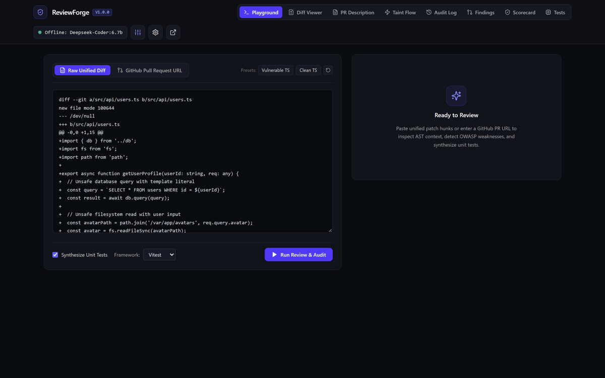
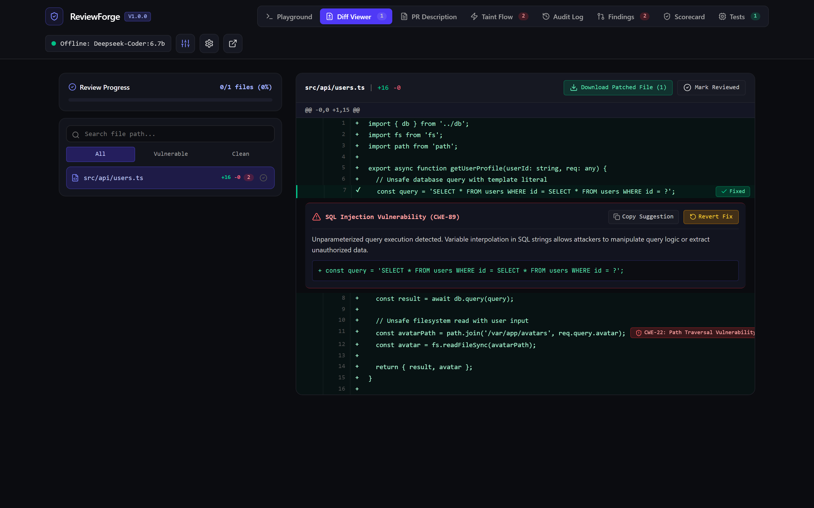
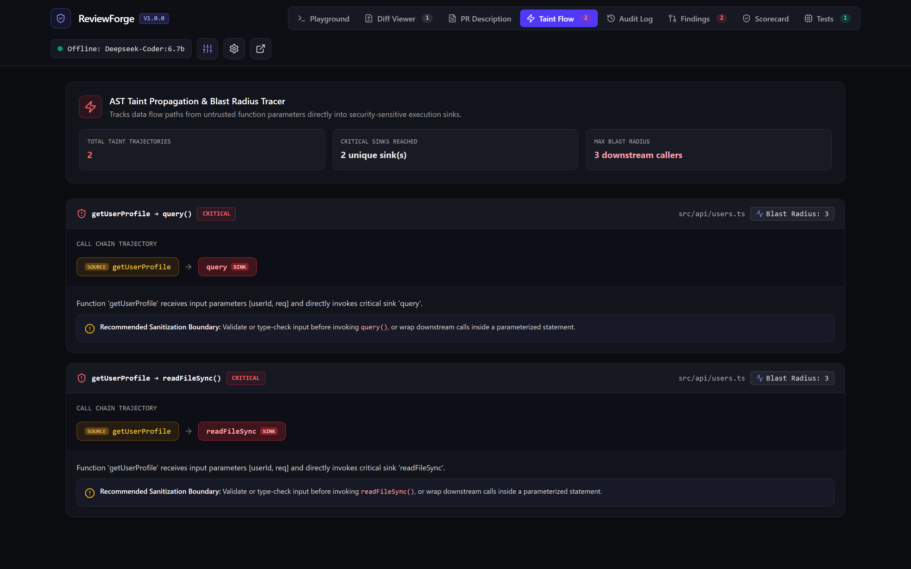
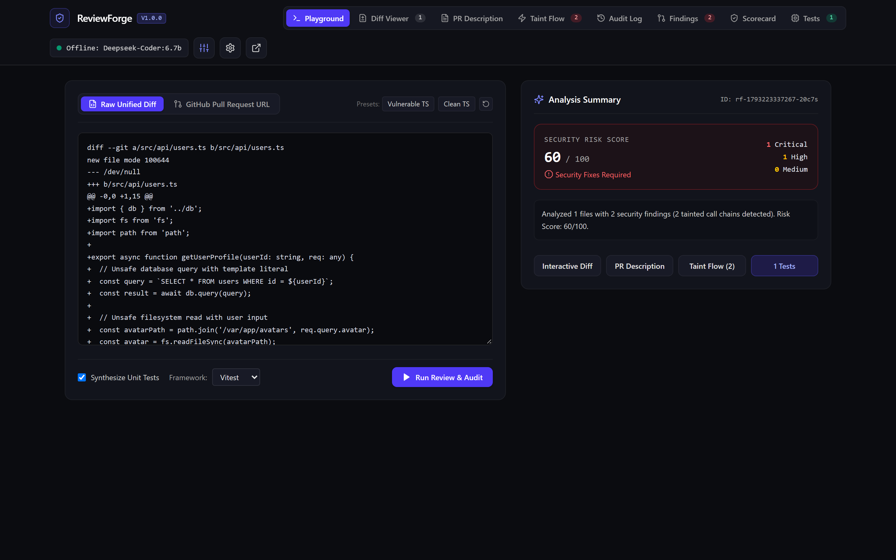
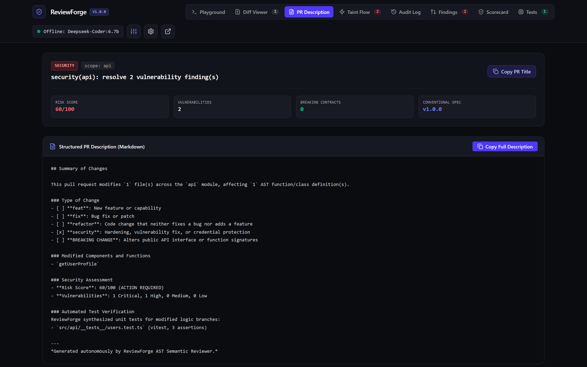
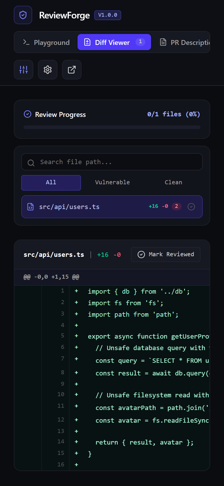

<p align="center">
  
</p>

<h1 align="center">ReviewForge</h1>

<p align="center">
  <strong>Self-hosted AI pull request reviewer, AST semantic diff auditor, and automated unit test synthesizer.</strong>
</p>

<p align="center">
  
</p>

ReviewForge is a private code review engine that runs on your own infrastructure as a CLI command or a webhook daemon. It parses Git diffs down to their enclosing Abstract Syntax Tree (AST) scopes, scans for OWASP vulnerabilities using deterministic AST rules, synthesizes runnable unit tests for new logic branches, and posts actionable multi-line suggestions directly to GitHub pull requests.

## Key Capabilities

- **AST Semantic Diffing**: Expands raw patch hunks into their full enclosing functions, methods, and class declarations for JavaScript, TypeScript, Python, and Go files.
- **OWASP Pre-Merge Auditing**: Scans modified code for SQL injection, path traversal, hardcoded secrets, command injection, ReDoS, and SSRF vulnerabilities mapped to CWE identifiers.
- **Automated Unit Test Synthesizer**: Generates complete, runnable test files for newly added or modified functions across Jest, Vitest, Pytest, and Go testing frameworks.
- **One-Click GitHub Suggestions**: Posts review comments formatted as markdown suggestion blocks that authors can commit directly from the GitHub pull request UI.
- **Model Agnostic with Zero Code Retention**: Connects to local Ollama instances (such as DeepSeek-Coder or Qwen 2.5) for fully offline analysis, or private commercial endpoints (Claude 3.5 Sonnet, GPT-4o, Gemini 2.0 Flash). When no model is configured, ReviewForge operates deterministically using static AST rules.
- **SARIF Code Scanning Export**: Produces SARIF 2.1.0 output for native GitHub Code Scanning and security tab integration.
- **AST Taint and Blast Radius Tracer**: Traces input propagation from untrusted function parameters downstream into critical execution sinks (database queries, shell executions, filesystem reads) and calculates blast radius caller impact.
- **Conventional PR Description and Changelog Synthesizer**: Generates structured Conventional Commits pull request descriptions, breaking change summaries, and changelog entries directly from AST semantic diffs.
- **Interactive In-Browser Custom Rule Sandbox**: Allows teams to author, test against sample code, and persist custom regex rules to `.reviewforge.yml`.
- **One-Click Inline Fixes and Patched Diff Download**: Resolves vulnerabilities directly inside the web diff viewer, updates line displays with color-coded states, and exports clean patched files.
- **PR Audit Log and Re-Review Workflow**: Records every manual review and webhook event, with historical tracking and 1-click re-review execution.
- **Reviewer Progress Tracker and File Filters**: Tracks file review completion status with a visual progress bar, file path search, and vulnerability status filtering.
- **Interactive Web Studio**: Fastify daemon on port 9440 with a React 19 dashboard for live diff analysis, test downloads, and security scorecards.

## Architecture

ReviewForge operates in five sequential stages:

```
Unified Diff -> AST Scope Expander -> Static OWASP Scanner -> Unit Test Synthesizer -> GitHub Reviewer / Web Studio
```

1. **Diff Parsing**: Extracts file paths, added lines, deleted lines, and hunk headers (`@@ -old +new @@`). Computes precise GitHub comment position indices.
2. **Context Expansion**: Locates enclosing AST nodes for changed lines using `@babel/parser` and language inspectors.
3. **Security Linter**: Runs deterministic AST visitor rules to detect dangerous APIs, unsanitized inputs, and leaked credentials.
4. **Test Generator**: Analyzes function parameters, return types, and branch conditions to generate happy path, boundary, and error tests.
5. **PR Review Publisher**: Submits structured pull request reviews via Octokit with multi-line suggestion blocks and a risk matrix summary.

## Management Studio

ReviewForge includes a Fastify daemon and React 19 studio for visual diff inspections, inline remediation, and data flow tracking.

### Interactive AST Diff Viewer and Inline Remediation
Apply suggested fixes directly inside the diff view and download patched files without leaving the browser.

<p align="center">
  
</p>

### AST Taint Flow and Blast Radius Tracer
Trace untrusted parameters through local call chains to dangerous execution sinks.

<p align="center">
  
</p>

### Diff Playground and Risk Scorecard
Inspect raw unified patches or fetch remote pull requests with instant OWASP scoring.

<p align="center">
  
</p>

### Conventional PR Description Synthesizer
Generate conventional commit titles, markdown descriptions, and changelogs automatically from AST analysis.

<p align="center">
  
</p>

### Responsive Layout
Full functionality across desktop monitors, laptops, tablets, and mobile devices.

<p align="center">
  
</p>

## Installation

```bash
# Clone the repository
git clone https://github.com/alexandrmotologa/reviewforge.git
cd reviewforge

# Install root dependencies
npm install

# Build TypeScript backend and React 19 studio
npm run build
```

## CLI Usage

ReviewForge provides a command-line interface for local and remote reviews:

### Review Local Changes

Run a review on uncommitted changes in your current working tree before pushing:

```bash
node dist/cli.js review --diff
```

### Review Remote Pull Request

Review an open pull request on GitHub:

```bash
export GITHUB_TOKEN="ghp_yourTokenHere"
node dist/cli.js review --pr "owner/repo/42"
```

### Generate Unit Tests

Synthesize unit tests for all exported functions in a source file:

```bash
node dist/cli.js test-gen src/auth/token_verifier.ts --framework vitest
```

### Run Security Audit

Scan a file or directory with the static OWASP AST rules without calling an LLM:

```bash
node dist/cli.js audit src/
```

### Start Webhook Server and Web Studio

Launch the Fastify daemon and React 19 interface on port 9440:

```bash
node dist/cli.js serve --port 9440
```

Open `http://localhost:9440` in your browser to access the management studio.

## Configuration

Set configuration variables in a `.env` file or export them in your shell:

```bash
# Server Port
PORT=9440

# GitHub Integration
GITHUB_TOKEN=ghp_exampleToken
GITHUB_WEBHOOK_SECRET=your_webhook_hmac_secret

# Local LLM (Ollama)
OLLAMA_HOST=http://localhost:11434
OLLAMA_MODEL=deepseek-coder:6.7b

# Cloud LLM Providers (Optional)
OPENAI_API_KEY=sk-example
OPENAI_MODEL=gpt-4o
ANTHROPIC_API_KEY=sk-ant-example
ANTHROPIC_MODEL=claude-3-5-sonnet-20241022
GEMINI_API_KEY=example-key
GEMINI_MODEL=gemini-2.0-flash
```

## Security Rules

| Rule ID | Weakness | Default Severity | CWE |
|---|---|---|---|
| `sql-injection` | Unparameterized queries in template literals | Critical | CWE-89 |
| `path-traversal` | Unvalidated inputs passed to file system APIs | High | CWE-22 |
| `auth-leak` | Hardcoded access tokens and unauthenticated routes | Critical | CWE-798 |
| `command-injection` | Shell executions with concatenated variables | Critical | CWE-78 |
| `insecure-regex` | Catastrophic backtracking with nested quantifiers | Medium | CWE-1333 |
| `ssrf` | Dynamic URL targets in outbound HTTP requests | High | CWE-918 |
| `cors-csrf` | Wildcard CORS origin with credentials enabled | Medium | CWE-942 |

## Testing

Run the test suite using Vitest:

```bash
npm test
```

## License

MIT
